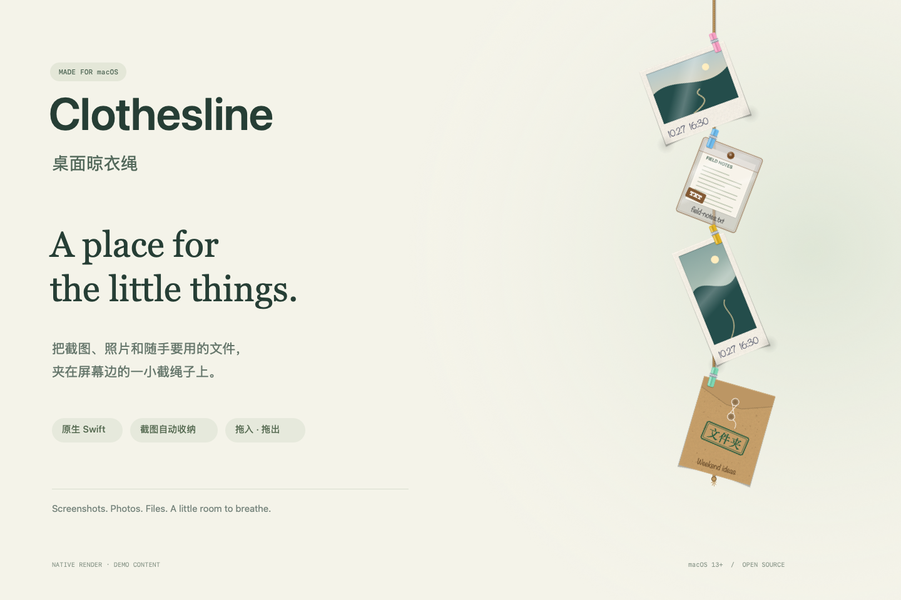
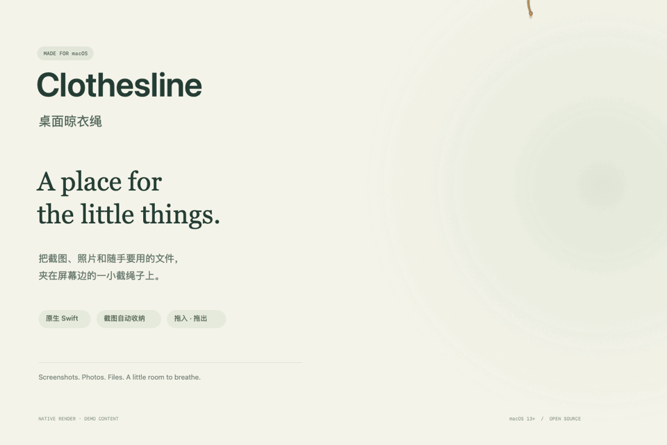

<div align="center">

# Clothesline · 桌面晾衣绳

**把截图、照片和随手要用的文件，夹在屏幕边的一小截绳子上。**

A tiny, tactile home for the little things on your Mac.

[](https://github.com/MiWang0608/Clothesline/releases/latest)
[](Package.swift)
[](LICENSE)

[**下载终端版**](https://github.com/MiWang0608/Clothesline/releases/latest) · [English](README.en.md) · [详细使用说明](docs/guide.zh-CN.md) · [反馈问题](https://github.com/MiWang0608/Clothesline/issues)



</div>

## 给桌面留一点呼吸的空间

截图、临时要发的照片、刚下载的文件，总要找个地方放。Clothesline 在屏幕右上角留一小截麻绳：鼠标停上去，它就落下来，把这些零碎的东西夹好；不用时，又轻轻收回去。

原生 **Swift + AppKit**，常驻菜单栏，不占 Dock 位置，没有第三方包依赖。

| 随手放下 | 随时取用 | 一点小细节 |
| --- | --- | --- |
| 新截图自动飞上绳子 | 拖到聊天窗口或访达 | 会晃动的麻绳和彩色木夹 |
| 从访达拖入图片、文件、文件夹 | 单击快速预览，双击打开 | 完整保留比例的拍立得 |
| 照片归档，普通文件保留原位 | 右键拷贝、共享、在访达中显示 | 透明文件袋与牛皮纸档案袋 |

## 看它展开

<div align="center">

</div>

*展示图和动图调用项目实际的卡片、麻绳绘制代码及弹簧计算生成，使用专门制作的演示素材与排版背景；不是私人桌面截图。动图展示展开与收起，截图飞入等交互请在应用内体验。*

## 下载就能运行

**使用编译好的版本，不需要安装 Xcode 或 Swift 开发环境。**

1. 打开 [Releases](https://github.com/MiWang0608/Clothesline/releases/latest)，下载与你的 Mac 匹配的压缩包。

   | 你的 Mac | 下载文件 |
   | --- | --- |
   | Apple Silicon，M 系列芯片 | `Clothesline-0.1.0-macOS-arm64.zip` |
   | Intel 芯片 | `Clothesline-0.1.0-macOS-x86_64.zip` |

2. 解压，打开终端。输入 `cd `（末尾有空格），把解压后的文件夹拖进终端，按回车。
3. 运行：

   ```bash
   ./Clothesline
   ```

4. 保持终端窗口开启，把鼠标移到屏幕右上角的小绳结，展开绳子。

需要 **macOS 13 或更高版本**。第一次运行时，如系统询问桌面访问权限，允许后才能自动收纳截图。退出使用菜单栏回形针 →「退出 Clothesline」，或在终端按 `Ctrl-C`。

**首次打开**：这是采用临时签名的个人项目，尚未经过 Apple Developer ID 签名和公证。如果 macOS 阻止运行，确认下载来源后，按 [Apple 官方说明](https://support.apple.com/102445)在「系统设置 → 隐私与安全性」中允许打开。不要全局关闭系统安全功能，也不要绕过恶意软件警告。

## 文件会发生什么

| 放上绳子的内容 | 存放方式 | 从绳子上取下 |
| --- | --- | --- |
| 截图、普通图片 | **移动**到应用自己的 `Images/` 目录；源文件无法移动时尝试复制 | 拖出后至少保留 24 小时，在之后启动应用时清理；右键摘掉则进废纸篓 |
| 文档、压缩包、文件夹等 | 仅记录原文件路径，**不移动**原文件 | 只移除引用，原文件不动 |

数据保存在 `~/Library/Application Support/Clothesline/`。所有处理均在本机完成，项目没有网络请求代码。

## 使用中的几个约定

- **截图不会立刻出现**：要等系统浮动缩略图消失、截图文件写入保存目录，通常约 5 秒。
- **只显示在主显示器**；挂满后可以上下滚动。
- **从访达拖入最可靠**：尚不支持没有真实文件路径的「文件承诺」式拖拽，例如部分应用直接拖出的图片。
- **终端版需要手动启动**；菜单里的「开机自动启动」需要 `.app` 包装才生效。
- Intel 版已交叉编译完成，尚未在实体 Intel Mac 上验证。
- 这是早期个人项目，界面交互仍需在不同 Mac 上继续验证。[完整操作与已知限制 →](docs/guide.zh-CN.md)

## 从源码运行

开发时需要 macOS 13+ 和带 Swift 5.9+ 的开发工具链。

```bash
git clone https://github.com/MiWang0608/Clothesline.git
cd Clothesline
swift run Clothesline
```

```bash
swift test                          # 22 个核心逻辑测试
scripts/package-release.sh 0.1.0     # 编译并打包 arm64 / x86_64 终端版
scripts/render-preview.sh           # 用原生绘制代码重新生成展示图和动图
```

本次发布前，22 个测试在 macOS 上全部通过。测试覆盖存储、文件引用、延迟清理、截图识别和目录监听；界面部分不包含自动化测试。预览渲染不读取你的桌面或应用数据。

<details>
<summary>项目结构与调试</summary>

```text
Sources/
  Clothesline/           AppKit 界面、卡片绘制、弹簧动画和交互
  ClotheslineCore/       条目存储、截图识别、目录监听和文件类型
Tests/
  ClotheslineCoreTests/  核心逻辑测试
scripts/                 打包与预览渲染脚本
tools/preview/           使用演示素材的原生展示图渲染器
docs/                    详细说明与展示素材
```

用独立数据目录调试：

```bash
CLOTHESLINE_ROOT=/tmp/clothesline-test swift run Clothesline -keepRopeOpen YES
```

这只改变应用数据目录，自动截图监听仍使用系统截图保存位置；如不希望收纳真实截图，请先在菜单栏暂停自动夹截图。

</details>

## 一起把它做好

遇到问题或有想法，欢迎[开一个 Issue](https://github.com/MiWang0608/Clothesline/issues)，附上 macOS 版本、芯片类型与复现步骤。分享截图时请先检查其中的私人信息。

[MIT License](LICENSE) · Made with Swift, AppKit, and a little curiosity.
